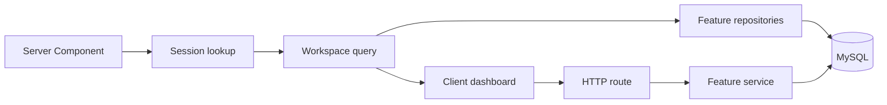

# 01 · Project architecture

## Concepts and technology

- **Next.js App Router** file names ko URLs se map karta hai. `app/page.tsx` home screen hai aur `app/api/workspace/route.ts` HTTP handler hai. Ek project mein routing, server rendering aur API milti hain. Separate Express service bhi possible hai, lekin usse alag deployment aur network hop add hota.
- **React components** screen ko reusable pieces mein divide karte hain. Props input data carry karti hain. `WorkspaceClient` ka `useState` latest workspace snapshot hold karta hai. `useSyncExternalStore` browser hash changes subscribe karta hai, isliye browser Back bhi section restore kar sakta hai. `useEffect` se initial client fetch karne par sign-in ke baad ek extra request aur loading state add hoti. Yahan Server Component initial data deta hai.
- **TypeScript** `Workspace` jaise DTOs ko compile time par check karta hai. Browser se aaya data runtime par alag validation maangta hai. Plain JavaScript mein hand-maintained contracts sambhav hain, aur missing fields aksar runtime par milti hain.
- **CSS and Tailwind** `globals.css` mein Tailwind preflight defaults aur CSS variables use hote hain. Grid aur media queries desktop sidebar aur mobile top navigation set karti hain. CSS Modules styles ko file-local kar sakte hain. Shared rules rakhne se forms aur rows consistent hain.
- **REST-style Route Handlers** method, request body aur status codes readable rakhte hain. Server Actions form integration automate kar sakte hain. Route Handlers choose kiye kyunki upload, download aur authentication ko same HTTP contract se browser aur tests exercise kar sakte hain.

## Actual flow

`src/app/page.tsx` request cookie se user resolve karta hai aur `getWorkspace` safe DTOs fetch karta hai. `Suspense` initial shell dikha sakta hai jab server data load kar raha ho. Browser form `MutationForm` se POST karta hai. Handler identity check karke `changeWorkspace` ko call karta hai. Service validation aur safe SQL queries chalati hai. Success ke baad ek GET fresh data laata hai. Dashboard read-only views initial DTO par render hote hain. Browser components mein DB credentials ya query helpers import karne par Next.js ka `server-only` guard build mein error dega.

## Code and debugging

Start with [page](../../src/app/page.tsx), [workspace commands](../../src/modules/workspace/commands.ts), [shared form](../../src/components/mutation-form.tsx) and [client dashboard](../../src/modules/workspace/workspace-client.tsx). Common mistake ye hai ki compile-time type ko API validation samajh lo. Agar save success ho aur card update na ho, Network panel mein POST aur uske baad GET check karo. POST 200 aur GET 503 ho to data save ho sakta hai. Refresh dabao aur server logs mein DB error code verify karo. UI ye distinction message mein dikhati hai.

## Interview practice

1. Server Component kyu use hua? **Answer** Initial protected data server par load karne ke liye aur DB logic client se bahar rakhne ke liye.
2. Props aur state ka difference? **Answer** Props parent ke inputs hain. State component ke lifecycle mein update hoti hai.
3. Route Handler aur service mein kya antar hai? **Answer** Handler HTTP protocol sambhalta hai. Service business rules implement karti hai.
4. **Debugging** Dashboard khulta hai, mutations fail hoti hain. **Solution** POST response ka status check karo. 403 aane par `APP_ORIGIN`, browser origin aur account role compare karo.
5. **Challenge** Dashboard mein unread count ka link add karo. **Solution** `data.unread` render karo aur link ko `#notifications` par point karo. Count ke liye alag request ki zarurat nahi.
